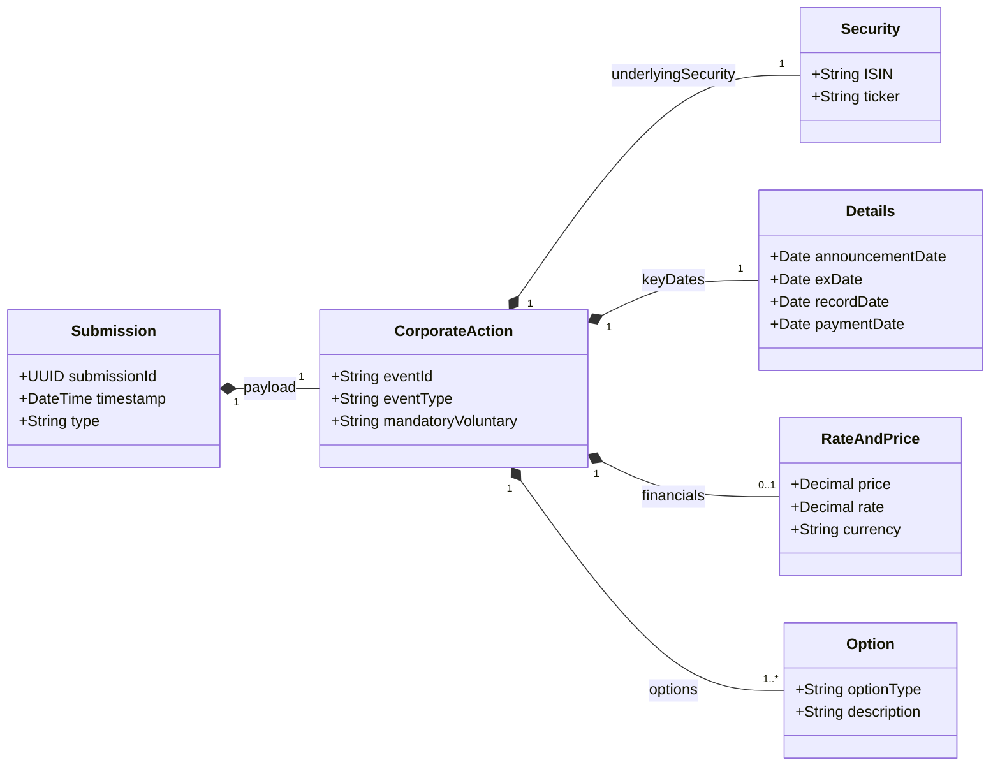

# Exchange Digital Platform Data Model

## 1. Overview

This document defines the standardised data model for all submissions to the exchange. The model adopts a **Generic Submission Envelope** pattern to handle various submission types (Disclosures, Waivers, Pricing), with a specific focus on **Corporate Actions** which aligns with the **ISO 20022** standard (specifically `seev.031` - Corporate Action Notification).

## 2. Generic Submission Envelope

All API requests to the platform must be wrapped in this standard envelope. This ensures consistent handling of metadata, auditing, and routing across the platform.

### 2.1 Envelope Schema

| Field | Type | Description | Required |
| :--- | :--- | :--- | :--- |
| `header` | Object | Standard submission metadata. | Yes |
| `header.submissionId` | UUID | Unique identifier for the submission attempt. | Yes |
| `header.timestamp` | ISO8601 | Time of submission (UTC). | Yes |
| `header.submitterId` | String | Identity of the Issuer or Agent. | Yes |
| `header.submissionType` | Enum | Discriminator for the payload. Values: `PROPRIETARY`, `CORPORATE_ACTION`, `WAIVER_REQ`. | Yes |
| `payload` | Object | The domain-specific data. Structure depends on `submissionType`. | Yes |

---

## 3. Corporate Action Data Model (ISO 20022)

For `submissionType: "CORPORATE_ACTION"`, the payload follows the structure of an ISO 20022 **Corporate Action Notification**.

### 3.1 Domain Model (UML Class Diagram)



### 3.2 Field Definitions

#### A. General Information (`CorpActnGnlInf`)
*   **Event Type** (`EvtTp`): The nature of the event.
    *   `DVCA`: Cash Dividend
    *   `SPLF`: Stock Split
    *   `MRGR`: Merger
    *   `RHTS`: Rights Issue
*   **Mandatory/Voluntary** (`MndtryVlntryEvtTp`):
    *   `MAND`: Mandatory (e.g., Stock Split)
    *   `VOLU`: Voluntary (e.g., Tender Offer)
    *   `CHOS`: Mandatory with Choice (e.g., Dividend Reinvestment)

#### B. Underlying Security (`UndrlygScty`)
*   Identifies the financial instrument affected by the event.
*   **ISIN**: International Securities Identification Number.
*   **Ticker**: Exchange symbol.

#### C. Details & Dates (`CorpActnDtls`)
*   **Announcement Date**: Date the event is publicly announced.
*   **Ex-Date**: Date from which the security trades without the benefit.
*   **Record Date**: Date ownership is determined.
*   **Payment Date**: Date funds/securities are distributed.

#### D. Options (`CorpActnOptn`)
*   Describes the choices available to shareholders.
    *   **Option Code**: `CASH` (Receive Cash), `SECU` (Receive Securities), `LAPS` (Take no action).

### 3.3 JSON Example: Cash Dividend (`DVCA`)

```json
{
  "header": {
    "submissionId": "a1b2c3d4-e5f6-7890-a1b2-c3d4e5f67890",
    "timestamp": "2024-10-15T09:30:00Z",
    "submitterId": "ISSUER_123",
    "submissionType": "CORPORATE_ACTION"
  },
  "payload": {
    "corporateActionGeneralInformation": {
      "officialCorporateActionEventID": "CA_2024_DIV_001",
      "eventType": "DVCA",
      "mandatoryVoluntaryEventType": "MAND"
    },
    "underlyingSecurity": {
      "isin": "AU000000BHP4",
      "ticker": "BHP"
    },
    "corporateActionDetails": {
      "dates": {
        "announcementDate": "2024-10-15",
        "exDate": "2024-11-01",
        "recordDate": "2024-11-02",
        "paymentDate": "2024-11-15"
      },
      "rateAndPrice": {
        "grossDividendRate": {
           "amount": 0.75,
           "currency": "AUD"
        }
      }
    },
    "options": [
      {
        "optionNumber": "001",
        "optionType": "CASH",
        "defaultOption": true
      }
    ]
  }
}
```
