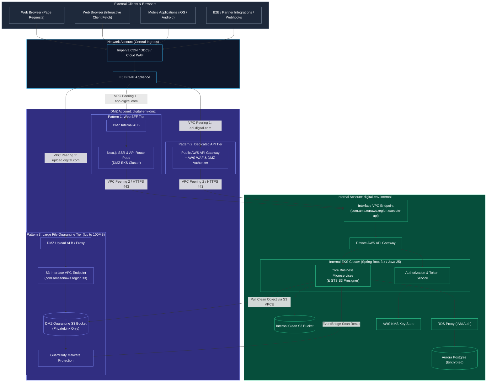
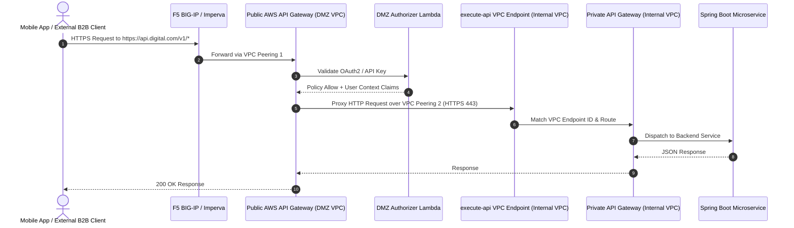
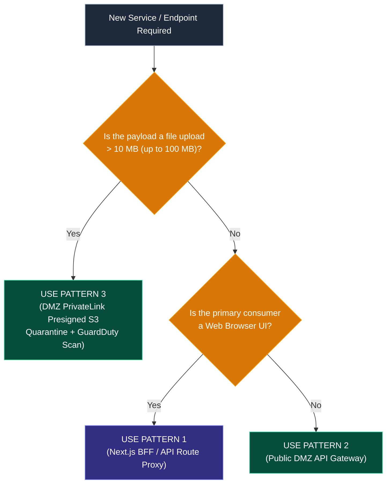

# Architecture Design: DMZ API Ingress & Compute Deployment Patterns

**Document Status:** Approved for Review  
**Target Platform:** AWS Multi-Account (DMZ & Internal VPCs)  
**Tenant:** Digital  
**Environments:** SDLC (Dev, QA, UAT, Prod)  
**Authors:** Principal AWS Architect & Cyber/Application Architect  

---

## 1. Executive Summary & Problem Statement

### 1.1 Context & Business Drivers
The Digital platform adopts a defense-in-depth, multi-account AWS architecture separating the **DMZ VPC** (untrusted external boundary) from the **Internal VPC** (core business services, Aurora databases, and KMS keys). 

* **Cyber Security Mandate:** All externally reachable services must have a dedicated, stateless compute or API gateway tier residing strictly within the **DMZ VPC** to terminate external traffic, enforce WAF rules, and prevent untrusted internet traffic from establishing direct network connections to internal data stores.
* **Application Team Goal:** Core business microservices (Spring Boot 3.x / Java 25), transactional databases (Aurora PostgreSQL), and cryptographic keys (AWS KMS) must remain centralized and protected within the **Internal VPC**.

### 1.2 The Hybrid Architecture Solution
To satisfy both requirements without duplicating monolithic services, the platform adopts a **Hybrid DMZ Ingress Model**:
1. **Pattern 1 (Primary for Web Applications):** **Next.js BFF / API Route Proxy** — Handles all Web UI requests (both Server-Side Rendering and Client-Side Browser Interactive Actions) through a single, unified origin in the DMZ.
2. **Pattern 2 (Selective for Dedicated Client APIs):** **Public DMZ AWS API Gateway** — Directly serves external API consumers (Mobile Apps, B2B Partner Integrations, Webhooks, and direct REST clients) without routing through Next.js.
3. **Pattern 3 (Large File Ingestion > 10 MB up to 100 MB):** **DMZ PrivateLink Presigned S3 Quarantine Ingestion** — Bypasses the 10 MB AWS API Gateway payload limit using cryptographically **session-scoped**, **single-use (`If-None-Match: *`)**, **time-limited** S3 presigned `PUT` URLs routed strictly through Imperva WAF, F5 BIG-IP, DMZ ALB, and an S3 Interface VPC Endpoint (`com.amazonaws.<region>.s3`) into a DMZ Quarantine S3 bucket with automated malware scanning before Internal VPC promotion.

---

## 2. Hybrid Architecture Topology

All three patterns operate concurrently in the DMZ VPC, securely routing validated control-plane requests over a private cross-VPC interface (`execute-api` VPC Endpoint) into the Internal VPC, while isolating large binary uploads in a DMZ Quarantine S3 bucket until malware inspection passes.



---

## 3. Pattern 1: Next.js API Route Proxy / BFF (Web Applications)

### 3.1 Overview
Pattern 1 is the enterprise standard for Next.js web applications. It unifies both **Server-Side Rendered (SSR)** pages and **Client-Side Browser interactions** under a single web origin (`https://app.digital.com`).

```mermaid
sequenceDiagram
    autonumber
    actor Browser as User Browser
    participant DMZ_Next as Next.js Pod (DMZ EKS)
    participant VPCE as execute-api VPC Endpoint (Internal VPC)
    participant PrivAPIGW as Private API Gateway (Internal VPC)
    participant Int_Svc as Spring Boot Microservice (Internal VPC)

    rect rgb(30, 41, 59)
    Note over Browser,DMZ_Next: Flow 1A: Server-Side Page Load (SSR)
    Browser->>DMZ_Next: GET /dashboard (Session Cookie)
    DMZ_Next->>VPCE: SSR Internal Fetch (Attached Internal JWT)
    VPCE->>PrivAPIGW: Route to Private API Gateway
    PrivAPIGW->>Int_Svc: GET /v1/dashboard-summary
    Int_Svc-->>DMZ_Next: 200 OK (Domain Data JSON)
    DMZ_Next-->>Browser: 200 OK (Rendered HTML + Hydration Bundle)
    end

    rect rgb(49, 46, 129)
    Note over Browser,Int_Svc: Flow 1B: Client-Side Interactive Fetch (Button Click / Form Submit)
    Browser->>DMZ_Next: POST /api/v1/payments (httpOnly Session Cookie)
    Note over DMZ_Next: Next.js API Route validates session,<br/>strips untrusted headers, attaches Internal Bearer JWT
    DMZ_Next->>VPCE: POST /v1/payments (Cross-VPC Peering 2)
    VPCE->>PrivAPIGW: Validate Resource Policy & Route
    PrivAPIGW->>Int_Svc: Process Payment Transaction
    Int_Svc-->>DMZ_Next: 201 Created (Transaction Result)
    DMZ_Next-->>Browser: 201 Created (Sanitized JSON Result)
    end
```



### 3.2 Key Technical Advantages
1. **Maximum XSS Resistance (`httpOnly` Cookies):** Access tokens and refresh tokens are never exposed to browser JavaScript (`localStorage` / `sessionStorage`). The browser holds only an encrypted `httpOnly`, `Secure`, `SameSite=Strict` session cookie. Next.js in the DMZ exchanges this cookie for downstream JWTs before calling the Internal VPC.
2. **Zero CORS Configuration:** Because client-side `fetch('/api/*')` calls target the exact same domain as the HTML page, browser preflight `OPTIONS` requests and complex CORS headers are completely eliminated.
3. **Single DMZ Compute Footprint:** Next.js acts as the sole DMZ compute engine for the entire web journey.

### 3.3 Concrete Implementation Examples

#### Programmatic Route Handler (Token Exchange & Header Sanitization)
All API routes use programmatic handlers to enforce session validation, token exchange, and header sanitization before proxying to the Internal VPC:

```typescript
// app/api/v1/payments/route.ts (Next.js App Router in DMZ)
import { NextRequest, NextResponse } from 'next/server';
import { getInternalJwtFromSession } from '@/lib/auth';

const INTERNAL_API_BASE = process.env.INTERNAL_API_GATEWAY_URL; // e.g., https://vpce.internal.digital.local

export async function POST(req: NextRequest) {
  try {
    // 1. Extract session from httpOnly cookie & exchange for internal service JWT
    const internalJwt = await getInternalJwtFromSession(req);
    if (!internalJwt) {
      return NextResponse.json({ error: 'Unauthorized' }, { status: 401 });
    }

    const payload = await req.json();

    // 2. Proxy request across VPC boundary to Internal Private API Gateway
    const response = await fetch(`${INTERNAL_API_BASE}/v1/payments`, {
      method: 'POST',
      headers: {
        'Content-Type': 'application/json',
        'Authorization': `Bearer ${internalJwt}`,
        'X-Correlation-Id': req.headers.get('x-correlation-id') || crypto.randomUUID(),
      },
      body: JSON.stringify(payload),
    });

    const data = await response.json();
    return NextResponse.json(data, { status: response.status });
  } catch (error) {
    return NextResponse.json({ error: 'Internal Gateway Error' }, { status: 502 });
  }
}
```

---

## 4. Pattern 2: Public DMZ AWS API Gateway (Dedicated Direct APIs)

### 4.1 Overview
Pattern 2 establishes a dedicated **Public AWS API Gateway** in the DMZ VPC, protected by AWS WAF and custom Lambda authorizers. This pattern is reserved for endpoints that do not originate from the Next.js web application.



### 4.2 When to Use Pattern 2
* **Mobile Applications (iOS / Android):** Native apps managing tokens via OAuth2 PKCE.
* **B2B Partner Integrations:** Third-party corporate clients authenticating with mutual TLS (mTLS) or API keys.
* **Public Webhooks:** Inbound asynchronous notifications from payment gateways or external SaaS providers.
* **High-Throughput Non-UI APIs:** Microservices exposed to programmatic automation where rendering HTML is irrelevant.

### 4.3 Key Technical Configurations

#### OpenAPI Integration Definition for AWS API Gateway (`DMZ API Gateway`)
```yaml
openapi: "3.0.1"
info:
  title: "Digital Public DMZ Gateway"
  version: "1.0.0"
paths:
  /v1/partner/orders:
    post:
      summary: "Create Partner Order"
      security:
        - OAuth2Authorizer: []
      x-amazon-apigateway-integration:
        type: "http_proxy"
        httpMethod: "POST"
        uri: "https://execute-api.internal.digital.local/v1/partner/orders"
        connectionType: "VPC_LINK"
        connectionId: "${stageVariables.VPC_LINK_ID}"
        passthroughBehavior: "when_no_match"
```

---

## 5. Pattern 3: Large File Ingestion (> 10 MB up to 100 MB) via DMZ S3 PrivateLink Quarantine

### 5.1 Overview & Problem Statement
AWS API Gateway enforces a hard **10 MB payload limit**, while business workflows require uploading files currently up to **60 MB** with a target ceiling of **100 MB**. Furthermore, Cyber Security mandates that:
1. **No Public S3 Exposure:** S3 buckets must never be directly reachable from the public internet (`*.s3.amazonaws.com`); all upload bytes must traverse **Imperva WAF → F5 BIG-IP → DMZ ALB/Proxy → DMZ S3 Interface VPC Endpoint (`com.amazonaws.<region>.s3`)**.
2. **Session-Scoped:** Each presigned upload URL must be cryptographically bound to the authenticated user's session, exact file size, and SHA-256 payload checksum.
3. **One-Time Usage:** A presigned URL must be strictly write-once; any replay attempt within the validity window must be rejected natively by S3.
4. **Time-Limited:** Presigned URLs and their underlying STS credentials must expire within a short TTL (e.g., 180 seconds).
5. **Quarantine & Malware Inspection:** Uploaded files must land in an isolated **DMZ Quarantine S3 Bucket** and pass **Amazon GuardDuty Malware Protection for S3** before being pulled into the Internal VPC.

### 5.2 End-to-End Sequence Flow (Both Pattern 1 Web & Pattern 2 API Clients)

```mermaid
sequenceDiagram
    autonumber
    actor Client as Browser (Pattern 1) / B2B Client (Pattern 2)
    participant Ingress as Imperva WAF + F5 BIG-IP
    participant DMZ_Ctrl as Next.js BFF (P1) / DMZ API GW (P2)
    participant Int_Svc as Internal Upload Service (Spring Boot)
    participant S3_VPCE as DMZ S3 Interface VPCE -> Quarantine S3
    participant Scanner as GuardDuty Malware Protection (DMZ)

    rect rgb(30, 41, 59)
    Note over Client,Int_Svc: Phase 1: Control Plane — Mint Session-Scoped, Single-Use Presigned URL (< 2 KB JSON)
    Client->>Client: Compute File Size (<= 100 MB) & SHA-256 Checksum
    Client->>Ingress: POST /v1/uploads/presign {fileName, contentLength, sha256, contentType}
    Ingress->>DMZ_Ctrl: Forward Request
    DMZ_Ctrl->>Int_Svc: Validate Session/JWT -> Forward with UserId & SessionId (via execute-api VPCE)
    Int_Svc->>Int_Svc: Validate contentLength <= 100 MB & AssumeRole with Inline Session Policy (TTL=180s)
    Int_Svc-->>Client: 200 OK { uploadId, uploadUrl: "https://upload.digital.com/...", requiredHeaders }
    end

    rect rgb(49, 46, 129)
    Note over Client,S3_VPCE: Phase 2: Data Plane — Direct Binary Stream via DMZ PrivateLink (Up to 100 MB)
    Client->>Ingress: PUT https://upload.digital.com/uploads/{sessionId}/{uploadId}\nHeaders: If-None-Match: *, x-amz-checksum-sha256, x-amz-meta-session-id
    Ingress->>S3_VPCE: F5 Host Rewrite -> DMZ ALB -> S3 Interface VPCE (TCP 443)
    S3_VPCE-->>Client: 200 OK (First Request) / 412 Precondition Failed (If Replayed)
    end

    rect rgb(6, 78, 59)
    Note over S3_VPCE,Int_Svc: Phase 3: Malware Scan & Internal VPC Promotion
    S3_VPCE->>Scanner: S3 ObjectCreated:Put Event
    Scanner->>Scanner: Scan Object in DMZ Quarantine Bucket
    Scanner->>Int_Svc: EventBridge Notification (NO_THREATS_FOUND)
    Int_Svc->>S3_VPCE: Pull Clean Object via S3 VPCE into Internal S3 & Enqueue Processing Job
    end
```



### 5.3 Cyber Control Implementation Details

| Cyber Requirement | Technical Enforcement Mechanism | Behavior on Violation |
| :--- | :--- | :--- |
| **No Public S3 Access** | S3 Block Public Access enabled + Bucket Policy `Deny` if `aws:SourceVpce != vpce-dmz-s3`. Binary stream routes via `Imperva -> F5 -> DMZ Upload ALB -> S3 Interface VPCE`. | Direct calls to `*.s3.amazonaws.com` fail with `403 Access Denied`. |
| **Session-Scoped** | Per-request `sts:AssumeRole` with `SessionId`/`UserId` session tags and an inline policy restricted to `arn:aws:s3:::quarantine-bucket/uploads/${sessionId}/${uploadId}`. Signed headers lock `x-amz-meta-session-id`, `content-length` ($\le 100\text{ MB}$), and `x-amz-checksum-sha256`. | Altering session metadata, file size, or file bytes invalidates the SigV4 signature (`403 SignatureDoesNotMatch` / `400 BadDigest`). |
| **One-Time Usage** | `If-None-Match: *` header is signed into `X-Amz-SignedHeaders` of the `PutObjectRequest`, and the upload IAM role has no `s3:DeleteObject` permission. | First upload succeeds (`200 OK`). Any subsequent replay to the same URL returns **`412 Precondition Failed`** natively from S3. |
| **Time-Limited** | SigV4 `X-Amz-Expires=180` (3 minutes, evaluated by S3 when the `PUT` starts) + STS inline session policy `DateLessThan` condition on `aws:CurrentTime`. | Expired URLs fail at S3 with `403 Access Denied`. |
| **DMZ Malware Isolation** | Amazon GuardDuty Malware Protection scans every object in the DMZ Quarantine bucket before emitting an EventBridge event to the Internal VPC. | Infected objects emit `THREATS_FOUND`, are quarantined/deleted in DMZ, and never enter the Internal VPC. |

### 5.4 S3 PrivateLink & SigV4 `Host` Header Resolution in the DMZ
Because AWS S3 validates the HTTP `Host` header against the SigV4 signature (`X-Amz-SignedHeaders=host;...`), routing `https://upload.digital.com` to the S3 Interface VPC Endpoint supports two deployment options:
* **Option A (Virtual-Hosted Bucket Name Matching):** Name the DMZ Quarantine bucket `upload.<env>.digital.com` and sign the presigned URL with virtual-hosted style (`Host: upload.<env>.digital.com`). F5 and the DMZ ALB forward the `Host` header untouched to the S3 Interface VPCE ENI IP targets.
* **Option B (F5 BIG-IP / Envoy `Host` Header Rewrite):** Name the bucket `digital-<env>-dmz-quarantine`, sign the presigned URL against `digital-<env>-dmz-quarantine.s3.ap-southeast-2.amazonaws.com`, return `https://upload.digital.com/...` to the client, and configure F5 BIG-IP (or DMZ Envoy) to rewrite `Host: digital-<env>-dmz-quarantine.s3.ap-southeast-2.amazonaws.com` before forwarding to the S3 Interface VPCE.

### 5.5 DMZ Quarantine S3 Bucket Policy
```json
{
  "Version": "2012-10-17",
  "Statement": [
    {
      "Sid": "DenyAllExceptDmzS3InterfaceVpce",
      "Effect": "Deny",
      "Principal": "*",
      "Action": "s3:PutObject",
      "Resource": "arn:aws:s3:::digital-prod-dmz-quarantine/*",
      "Condition": {
        "StringNotEquals": {
          "aws:SourceVpce": "vpce-0abc123def456dmzs3"
        }
      }
    },
    {
      "Sid": "RequireKmsEncryptionOnUpload",
      "Effect": "Deny",
      "Principal": {
        "AWS": "arn:aws:iam::111122223333:role/dmz-presigned-upload-role"
      },
      "Action": "s3:PutObject",
      "Resource": "arn:aws:s3:::digital-prod-dmz-quarantine/uploads/*",
      "Condition": {
        "StringNotEquals": {
          "s3:x-amz-server-side-encryption": "aws:kms"
        }
      }
    }
  ]
}
```

### 5.6 Internal Spring Boot Presigner Service (Java 21+ / AWS SDK v2)
```java
package com.pdfservice.pdf_service.adapters.outbound.storage;

import java.time.Duration;
import java.time.Instant;
import java.time.format.DateTimeFormatter;
import java.util.List;
import java.util.Map;
import software.amazon.awssdk.auth.credentials.AwsSessionCredentials;
import software.amazon.awssdk.auth.credentials.StaticCredentialsProvider;
import software.amazon.awssdk.regions.Region;
import software.amazon.awssdk.services.s3.model.ChecksumAlgorithm;
import software.amazon.awssdk.services.s3.model.PutObjectRequest;
import software.amazon.awssdk.services.s3.presigner.S3Presigner;
import software.amazon.awssdk.services.s3.presigner.model.PresignedPutObjectRequest;
import software.amazon.awssdk.services.s3.presigner.model.PutObjectPresignRequest;
import software.amazon.awssdk.services.sts.StsClient;
import software.amazon.awssdk.services.sts.model.AssumeRoleRequest;
import software.amazon.awssdk.services.sts.model.Credentials;
import software.amazon.awssdk.services.sts.model.Tag;

public class DmzS3PresignedUploadAdapter {

    private static final long MAX_UPLOAD_BYTES = 100L * 1024L * 1024L; // 100 MB
    private static final Duration URL_TTL = Duration.ofMinutes(3);

    private final StsClient stsClient;
    private final String uploadRoleArn;
    private final String quarantineBucket;
    private final Region region;

    public DmzS3PresignedUploadAdapter(
            StsClient stsClient, String uploadRoleArn, String quarantineBucket, Region region) {
        this.stsClient = stsClient;
        this.uploadRoleArn = uploadRoleArn;
        this.quarantineBucket = quarantineBucket;
        this.region = region;
    }

    public PresignedUploadTicket createSingleUseSessionScopedUrl(
            String sessionId,
            String userId,
            String uploadId,
            String contentType,
            long contentLength,
            String sha256Base64) {

        if (contentLength <= 0 || contentLength > MAX_UPLOAD_BYTES) {
            throw new IllegalArgumentException("File size must be between 1B and 100MB");
        }

        String objectKey = String.format("uploads/%s/%s", sessionId, uploadId);
        String hardExpiryIso = DateTimeFormatter.ISO_INSTANT.format(Instant.now().plus(URL_TTL));

        // 1. Scoped STS Inline Session Policy: Locked to single object key + 3-min cutoff
        String inlineSessionPolicy = """
            {
              "Version": "2012-10-17",
              "Statement": [{
                "Effect": "Allow",
                "Action": "s3:PutObject",
                "Resource": "arn:aws:s3:::%s/%s",
                "Condition": {
                  "DateLessThan": { "aws:CurrentTime": "%s" }
                }
              }]
            }
            """.formatted(quarantineBucket, objectKey, hardExpiryIso);

        Credentials stsCreds = stsClient.assumeRole(AssumeRoleRequest.builder()
                .roleArn(uploadRoleArn)
                .roleSessionName("upload-" + uploadId)
                .durationSeconds(900)
                .policy(inlineSessionPolicy)
                .tags(
                    Tag.builder().key("SessionId").value(sessionId).build(),
                    Tag.builder().key("UserId").value(userId).build()
                )
                .build()).credentials();

        // 2. Presign PUT with If-None-Match: *, exact Content-Length, SHA-256, and Session Metadata
        try (S3Presigner presigner = S3Presigner.builder()
                .region(region)
                .credentialsProvider(StaticCredentialsProvider.create(
                        AwsSessionCredentials.create(
                                stsCreds.accessKeyId(),
                                stsCreds.secretAccessKey(),
                                stsCreds.sessionToken())))
                .build()) {

            PutObjectRequest putRequest = PutObjectRequest.builder()
                    .bucket(quarantineBucket)
                    .key(objectKey)
                    .contentType(contentType)
                    .contentLength(contentLength)
                    .checksumAlgorithm(ChecksumAlgorithm.SHA256)
                    .checksumSHA256(sha256Base64)
                    .ifNoneMatch("*") // Enforces ONE-TIME USAGE natively in S3
                    .serverSideEncryption("aws:kms")
                    .metadata(Map.of(
                            "session-id", sessionId,
                            "user-id", userId,
                            "upload-id", uploadId))
                    .build();

            PresignedPutObjectRequest presigned = presigner.presignPutObject(
                    PutObjectPresignRequest.builder()
                            .signatureDuration(URL_TTL)
                            .putObjectRequest(putRequest)
                            .build());

            return new PresignedUploadTicket(
                    uploadId,
                    presigned.url().toString(),
                    presigned.signedHeaders());
        }
    }

    public record PresignedUploadTicket(
            String uploadId,
            String presignedUrl,
            Map<String, List<String>> requiredHeaders) {}
}
```

---

## 6. Cross-VPC Transport & Defense-in-Depth Security Controls

Regardless of whether control-plane requests originate from **Next.js (Pattern 1)** or **DMZ API Gateway (Pattern 2)**, all API traffic entering the Internal VPC must traverse the **Interface VPC Endpoint (`execute-api`)** over VPC Peering 2 under strict Layer 4 and Layer 7 constraints. Binary uploads (**Pattern 3**) terminate at the **DMZ S3 Interface VPC Endpoint** and are pulled asynchronously into the Internal VPC only after GuardDuty malware verification.

```
DMZ VPC (10.100.0.0/16)                             Internal VPC (10.200.0.0/16)
┌─────────────────────────┐                         ┌──────────────────────────────────────────────┐
│ Next.js Pods (EKS)      │ ──[ VPC Peering 2 ]──>  │ [ execute-api Interface VPC Endpoint ]      │
│ DMZ API Gateway         │    (TCP 443 Only)       │   - SG: Inbound 443 from 10.100.0.0/16 only  │
└─────────────────────────┘                         │   - Resource Policy: Allow only this VPCE ID │
                                                    │                      │                       │
┌─────────────────────────┐                         │                      ▼                       │
│ DMZ Upload ALB          │                         │ [ Private API Gateway ]                      │
│   │                     │                         │                      │                       │
│   ▼                     │                         │                      ▼                       │
│ S3 Interface VPCE (DMZ) │                         │ [ Internal Spring Boot EKS Services ]        │
│   │                     │                         │   - Pulls clean S3 objects post-GuardDuty    │
│   ▼                     │                         │                      │                       │
│ DMZ Quarantine S3       │ ◄──[ S3 VPCE Pull ]───  │                      ▼                       │
│ + GuardDuty Malware Scan│                         │ [ Aurora PostgreSQL (Port 5432) ]            │
└─────────────────────────┘                         │   - NO Route / NO Inbound from DMZ CIDR      │
                                                    └──────────────────────────────────────────────┘
```

### 6.1 Private API Gateway Resource Policy (Internal VPC)
Ensures that the Private API Gateway can **never** be reached directly by unauthorized network sources:

```json
{
  "Version": "2012-10-17",
  "Statement": [
    {
      "Effect": "Deny",
      "Principal": "*",
      "Action": "execute-api:Invoke",
      "Resource": "arn:aws:execute-api:ap-southeast-2:123456789012:api-id/*/*/*",
      "Condition": {
        "StringNotEquals": {
          "aws:SourceVpce": "vpce-0123456789abcdef0"
        }
      }
    },
    {
      "Effect": "Allow",
      "Principal": "*",
      "Action": "execute-api:Invoke",
      "Resource": "arn:aws:execute-api:ap-southeast-2:123456789012:api-id/*/*/*"
    }
  ]
}
```

### 6.2 Network & Security Group Baseline

| Component | Inbound Rules | Outbound Rules | Routing Notes |
| :--- | :--- | :--- | :--- |
| **DMZ EKS Worker Nodes (Next.js)** | HTTPS 443 from DMZ ALB | HTTPS 443 to `execute-api` VPCE IP | Route table routes `10.200.0.0/16` via `pcx-peering-2`. |
| **DMZ Upload ALB & S3 Interface VPCE** | HTTPS 443 from F5 BIG-IP | HTTPS 443 to DMZ S3 Interface VPCE ENIs | Terminates `upload.digital.com` privately inside DMZ VPC. |
| **`execute-api` VPCE (Internal VPC)** | HTTPS 443 strictly from DMZ Subnet CIDR (`10.100.0.0/16`) | None (Stateless endpoint interface) | Placed in Internal VPC Private Subnets. |
| **Aurora Postgres DB Subnets** | TCP 5432 strictly from Internal EKS App Subnets | None | **Zero route table entries to VPC Peering or NAT.** |

---

## 7. Architecture Decision Framework: Pattern 1 vs. Pattern 2 vs. Pattern 3

Use this decision matrix when onboarding new services or interfaces to determine the appropriate ingress pattern:



### Comparison Matrix

| Evaluation Criteria | Pattern 1: Next.js API Proxy / BFF | Pattern 2: Public DMZ API Gateway | Pattern 3: DMZ PrivateLink Presigned S3 |
| :--- | :--- | :--- | :--- |
| **Target Use Case** | Web Browsers (Next.js SSR & Client JS) | Mobile Apps, B2B Partners, Webhooks | Large File Uploads (> 10 MB up to 100 MB) |
| **Primary Domain** | `app.digital.com/api/*` | `api.digital.com/v1/*` | `upload.digital.com/uploads/*` |
| **Token / Auth Handling** | `httpOnly`, Secure Cookies $\rightarrow$ JWT Exchange | Bearer Tokens in Authorization Header | STS Session-Scoped SigV4 + `If-None-Match: *` + SHA-256 |
| **Payload Limit** | $\le 10\text{ MB}$ (Downstream Private API GW limit) | $\le 10\text{ MB}$ (AWS API Gateway hard limit) | **Up to $100\text{ MB}$** (Enforced via signed `Content-Length`) |
| **Replay / Reuse Protection** | Standard Idempotency Keys | Standard Idempotency Keys | **Strict Single-Use** (`If-None-Match: *` $\rightarrow$ `412`) |
| **WAF & Malware Controls** | Imperva WAF / ALB Rules | AWS WAF + API Gateway Throttling | Imperva WAF + **GuardDuty S3 Malware Scan** |
| **Cyber DMZ Compliance** | **100% Compliant** (Next.js is DMZ Compute) | **100% Compliant** (API GW is DMZ Compute) | **100% Compliant** (S3 VPCE + DMZ Quarantine) |

---

## 8. Confluence Summary & Action Items

1. **Adopt Pattern 1** for all Web Application flows (including requesting presigned upload tickets) to ensure token confidentiality and simplify frontend architecture.
2. **Provision Pattern 2** as a parallel, serverless DMZ gateway dedicated strictly to mobile apps, partner integrations, and webhooks.
3. **Implement Pattern 3** for all file uploads $> 10\text{ MB}$ (up to $100\text{ MB}$) by provisioning a DMZ Quarantine S3 Bucket behind an S3 Interface VPC Endpoint, enforcing session-scoped STS policies, `If-None-Match: *` one-time write preconditions, 3-minute TTLs, and GuardDuty Malware Protection before Internal VPC ingestion.
4. **Lock Down Cross-VPC Transport** using the `aws:SourceVpce` condition on both the Internal Private API Gateway and the DMZ Quarantine S3 Bucket Policy.
5. **Isolate Database Subnets** in the Internal VPC with zero route table entries to the DMZ peering connection.
